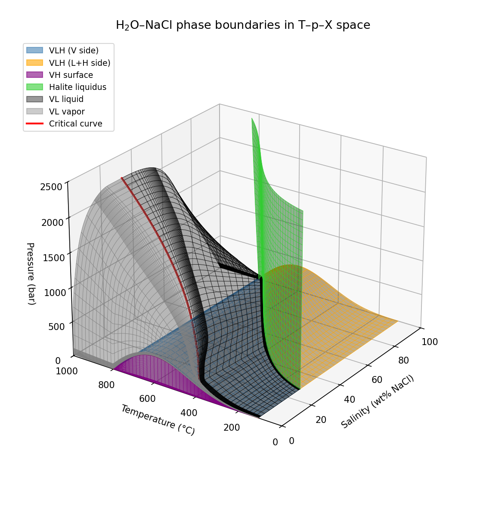
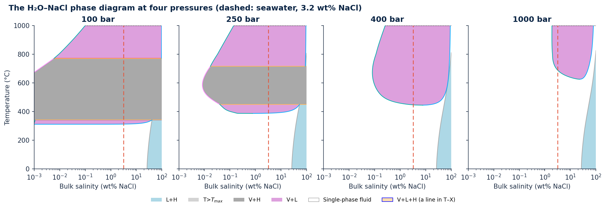
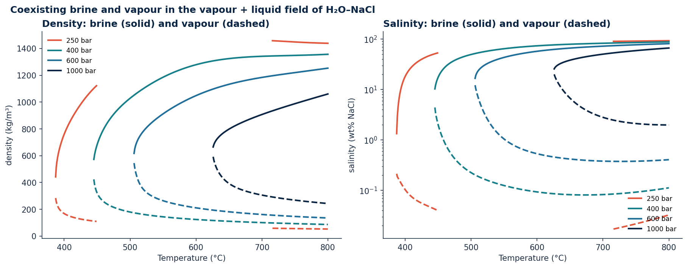
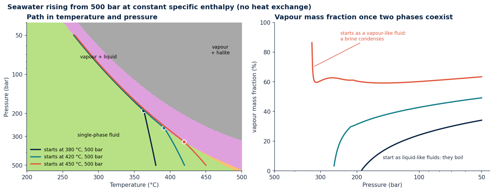
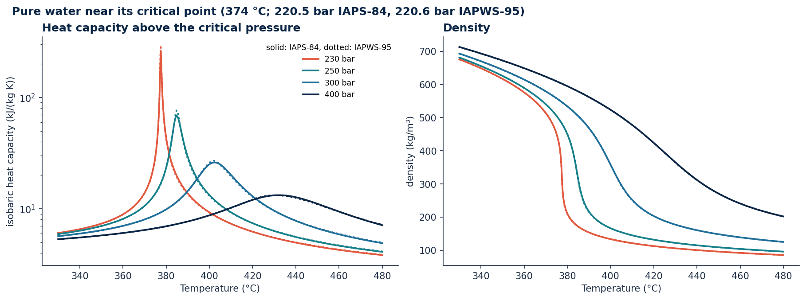

# Gallery

The following examples illustrate the phase relations and thermodynamic properties of H₂O–NaCl fluids calculated with xThermo. They highlight phenomena relevant to hydrothermal systems, including phase separation, boiling during decompression, and fluid behaviour near the critical point.

All calculations follow the formulations of Driesner & Heinrich (2007) and Driesner (2007), using the IAPS-84 water backend.

Each figure can be reproduced using the accompanying Python code, which is also included in the documentation's automated tests.

Additional examples are available on the [homepage](index.md) and in the Python guides to [phase diagrams](python/phase_diagrams.md) and [property maps](python/property_maps.md).

## The H₂O–NaCl phase diagram

<figure class="xt-figure" markdown>

</figure>

The phase relations of the H₂O–NaCl system form a three-dimensional structure in temperature–pressure–composition space. The two-dimensional phase diagrams shown below represent sections through this structure.

The vapour–liquid coexistence region is bounded by two surfaces representing the compositions of the coexisting liquid (dark grey) and vapour (light grey). These surfaces converge along the critical curve (red), where the distinction between liquid and vapour disappears.

At lower pressures, the vapour–liquid–halite three-phase surface connects the compositions of the coexisting phases (blue and orange). Below this surface, vapour and halite coexist (purple). On the salt-rich side of the diagram, the halite liquidus (green) separates the single-phase liquid region from the liquid–halite coexistence region.

The salinity axis is linear, making the very low NaCl concentrations of the vapour phase difficult to distinguish near the pure-water end of the diagram. The following two-dimensional sections use a logarithmic salinity scale to illustrate these regions in greater detail.

??? example "Python code"

    ```python
    --8<-- "docs/gallery/gallery_boundaries.py:diagram3d"
    ```

## How the phase diagram changes with depth

<figure class="xt-figure" markdown>

</figure>

The three-dimensional phase diagram can be explored through sections at constant pressure. The figure compares temperature–salinity sections at 100, 250, 400 and 1000 bar, corresponding approximately to hydrostatic pressures at depths of 1, 2.5, 4 and 10 km in seawater.

At 100 bar, seawater begins to separate into vapour and saline liquid at approximately 312 °C. Between 341 and 771 °C, vapour coexists with halite, indicating that the liquid brine has disappeared and salt has precipitated.

As pressure increases, phase separation begins at progressively higher temperatures: approximately 388 °C at 250 bar, 447 °C at 400 bar and 688 °C at 1000 bar.

The vapour–liquid–halite three-phase equilibrium is restricted to pressures below approximately 390 bar. At higher pressures, the phase relations change accordingly, while the halite liquidus on the salt-rich side of the diagram is comparatively insensitive to pressure.

??? example "Python code"

    ```python
    --8<-- "docs/gallery/gallery_sections.py:figure"
    ```

## Coexisting brine and vapour

<figure class="xt-figure" markdown>

</figure>

When H₂O–NaCl fluids undergo vapour–liquid phase separation, the coexisting phases can differ substantially in density and salinity. The liquid phase becomes enriched in NaCl, while the vapour generally contains much less dissolved salt.

The figure illustrates the temperature dependence of the density and salinity of coexisting liquid and vapour at pressures of 250, 400, 600 and 1000 bar.

At each pressure, the liquid and vapour branches converge at the critical curve, where the distinction between the two phases disappears. Away from the critical curve, density differences can exceed 1000 kg/m³, providing a strong driving force for gravitational phase separation. The salinity contrast can span several orders of magnitude.

Increasing pressure generally shifts the critical conditions towards higher temperatures and allows greater concentrations of NaCl in the vapour phase.

At 250 bar, the vapour–liquid region is interrupted between approximately 449 and 716 °C by vapour–halite equilibrium, where halite precipitates and no liquid phase is present.

The figure is restricted to temperatures below 800 °C. At higher temperatures, the published vapour-composition correlation requires an additional implementation choice, as discussed under [Implementation choices and formulation differences](limitations.md#implementation-choices-and-formulation-differences).

??? example "Python code"

    ```python
    --8<-- "docs/gallery/gallery_coexisting.py:figure"
    ```

## Rising seawater: boiling or condensation

<figure class="xt-figure" markdown>

</figure>

As hydrothermal fluids rise towards the seafloor, decreasing pressure can lead to phase separation. Whether vapour forms or liquid condenses depends on the initial thermodynamic state of the fluid.

The figure illustrates the isenthalpic decompression of three fluids with seawater salinity, initially at 500 bar and temperatures of 380, 420 and 450 °C. Their evolution is calculated at constant specific enthalpy, representing an idealised ascent without heat exchange or changes in kinetic and potential energy.

The two cooler fluids initially occupy liquid-like states. During decompression, they enter the vapour–liquid region at approximately 191 and 260 bar, respectively. Vapour is generated, and its proportion increases as pressure decreases.

The hottest fluid begins in a vapour-like state near the critical curve. As it decompresses, it enters the two-phase region from the vapour-rich side at approximately 331 bar, causing a small amount of saline liquid to condense rather than vapour to form.

At 50 bar, all three fluids coexist as vapour and brine at approximately 266 °C.

These idealised paths demonstrate the contrasting phase-separation behaviour of rising hydrothermal fluids. Natural hydrothermal circulation also involves heat exchange with surrounding rocks and fluid mixing, which are not represented in this example.

??? example "Python code"

    ```python
    --8<-- "docs/gallery/gallery_upflow.py:figure"
    ```

## Water near its critical point

<figure class="xt-figure" markdown>

</figure>

Near the critical point, the thermodynamic properties of water change rapidly with temperature and pressure. Above the critical pressure (approximately 220.5 bar), water transitions continuously between liquid-like and vapour-like states without crossing a phase boundary.

The figure compares density and isobaric heat capacity calculated with IAPS-84 and IAPWS-95 at pressures of 230, 250, 300 and 400 bar.

At pressures just above the critical pressure, the heat capacity exhibits a pronounced maximum, reflecting the strong temperature dependence of enthalpy in this region. With increasing pressure, this maximum becomes broader and shifts towards higher temperatures. These properties are important for understanding heat transport in hydrothermal systems.

Both water formulations predict similar behaviour across the investigated conditions. The largest differences occur near the heat-capacity maximum at 230 bar, where the calculated peak values differ by approximately 10%.

The IAPS-84 formulation has a restricted validity range immediately surrounding the critical point, and calculations in this region require particular care. Further discussion is provided under [Applicability and known limitations](limitations.md#applicability-and-known-limitations).

??? example "Python code"

    ```python
    --8<-- "docs/gallery/gallery_water.py:critical"
    ```

