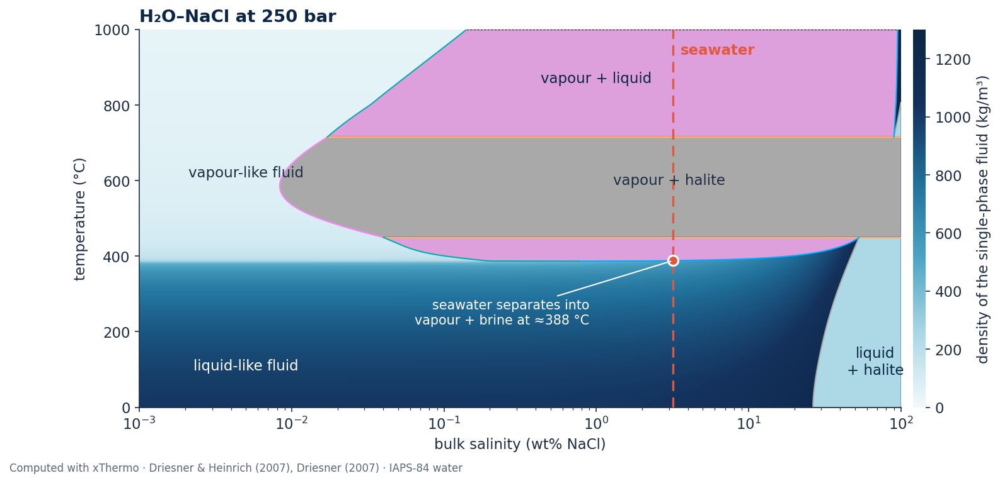
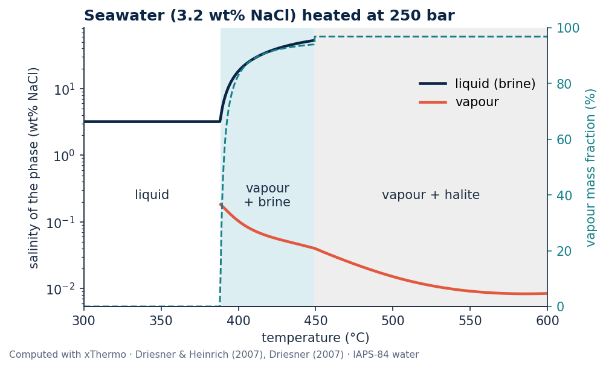

---
hide:
  - navigation
  - toc
---

<div class="xt-hero" markdown>

# xThermo

<p class="xt-tagline">Phase relations and thermodynamic properties of H₂O–NaCl fluids from 0 to 1000 °C and 1 to
5000 bar, after Driesner &amp; Heinrich (2007) and Driesner (2007). A C++ library for simulation codes, with a
Python interface for NumPy and Matplotlib.</p>

[Get started](installation.md){ .md-button .md-button--primary }
[Gallery](gallery.md){ .md-button }
[Model and limitations](limitations.md){ .md-button }

</div>

<figure class="xt-figure" markdown>
<picture>
  <source media="(max-width: 600px)" srcset="assets/img/hero_mobile.png">
  
</picture>
<figcaption>The phase relations of the H₂O–NaCl system at 250 bar, corresponding approximately to hydrostatic pressure at 2.5 km water depth. The diagram shows regions where liquid, vapour and halite coexist, alongside the density of the single-phase fluid, indicated by shades of blue. At seawater salinity (dashed line), phase separation begins at approximately 388 °C, producing a low-salinity vapour and a more saline liquid. The pronounced change in fluid density and the appearance of coexisting phases illustrate how temperature and salinity influence the behaviour of hydrothermal fluids.</figcaption>
</figure>

## What xThermo computes

<div class="grid cards" markdown>

-   :material-chart-bell-curve-cumulative: **Phase relations**

    ---

    Explore the stability and coexistence of liquid, vapour and halite across temperature, pressure and salinity,
    including the critical curve.

-   :material-water-thermometer: **Fluid properties**

    ---

    Calculate density, specific enthalpy, heat capacity, viscosity and thermodynamic derivatives for H₂O–NaCl
    fluids and their coexisting phases.

-   :material-language-python: **Python for science**

    ---

    Evaluate individual states or entire NumPy arrays, and create phase diagrams and thermodynamic property maps
    using Python.

-   :material-language-cpp: **C++ for simulation codes**

    ---

    Integrate xThermo into C++ simulation software through its CMake interface, with support for robust error
    handling and parallel applications.

-   :material-water: **Pure water and NaCl**

    ---

    Calculate properties of pure water using IAPS-84 or IAPWS-95, as well as solid and liquid NaCl.

-   :material-check-decagram: **Checked against the literature**

    ---

    The numerical implementation has been systematically verified against published reference data. See
    [Model and limitations](limitations.md) for details.

</div>

## Seawater heated at 250 bar

<figure class="xt-figure xt-figure--narrow" markdown>

<figcaption>The figure follows the evolution of seawater as it is heated at a constant pressure of 250 bar, corresponding to the dashed salinity line in the phase diagram above. Below approximately 388 °C, seawater remains a single liquid phase. At higher temperatures, it separates into a low-salinity vapour and a concentrated brine. As heating continues, the vapour fraction increases and the remaining liquid becomes progressively enriched in NaCl. At approximately 449 °C, the liquid phase disappears and halite precipitates. Further heating produces a mixture of vapour and solid halite. This sequence illustrates how phase separation can redistribute water and salt in hydrothermal systems, particularly near mid-ocean ridges.</figcaption>
</figure>

??? example "Python code for both figures"

    ```python
    --8<-- "docs/gallery/hero.py"
    ```

    The script uses a few shared style settings from
    [`docs/gallery/_style.py`](https://github.com/lruepke/xThermo/blob/main/docs/gallery/_style.py).

## Quick start

=== "Python"

    ```python
    import numpy as np
    import xthermo
    from xthermo import H2ONaCl

    sw = H2ONaCl.cH2ONaCl("IAPS84")                     # water backend: IAPS-84
    T = np.linspace(300, 600, 7) + 273.15               # K
    s = xthermo.tpx(sw, T, 250e5, 0.032)                # p in Pa, salinity in kg/kg
    for t, name, rho in zip(T - 273.15, s.phase_name, s.Rho):
        print(f"{t:5.0f} °C  {name:8s}  {rho:7.1f} kg/m³")
    ```

=== "C++"

    ```cpp
    #include "H2ONaCl.h"
    #include <iostream>
    using namespace xThermal;

    int main() {
        H2ONaCl::cH2ONaCl eos("IAPS84");
        ThermodynamicProperties props;
        eos.UpdateState_TPX(props, 573.15, 300e5, 0.1);  // T [K], p [Pa], X [kg/kg]
        std::cout << props.Rho << " kg/m3, " << eos.phase_name(props.phase) << std::endl;
    }
    ```

xThermo can currently be installed from source. See the [Installation](installation.md) guide for instructions
and requirements. Distribution through PyPI is planned for a future release.

<div class="xt-ack" markdown>
xThermo is developed and maintained by the [Seafloor Modeling group](https://www.geomar.de/en/research/fb4/fb4-muhs/research-topics/modelings) at the [GEOMAR Helmholtz Centre for Ocean Research Kiel](https://www.geomar.de).

The library implements the H₂O–NaCl formulations of Driesner &amp; Heinrich (2007) and Driesner (2007). Please cite these publications when using xThermo. For development credits, citation information and licensing, see [About](about.md).
</div>
