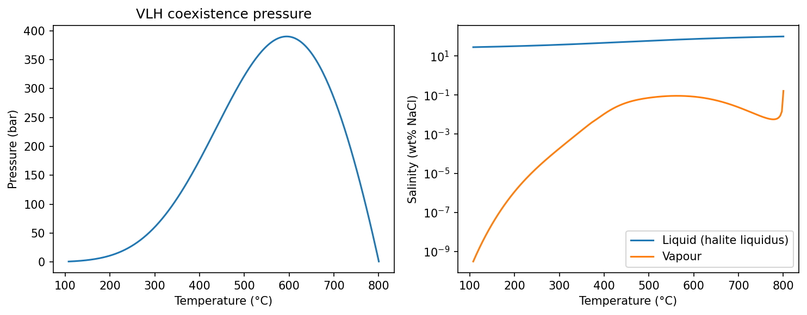

# Phase boundaries

The model object `cH2ONaCl` computes the phase boundaries of the H₂O–NaCl system directly: the three-phase surface
V+L+H, the critical curve, the halite liquidus and the compositions of coexisting phases. For complete sections
through the phase diagram use [Phase diagrams](phase_diagrams.md); for properties on grids, [Evaluating
states](evaluate.md). The [Gallery](../gallery.md) shows how the phase diagram changes with pressure.

These functions take and return SI units (K, Pa, kg/kg). They accept NumPy arrays, but return tuples or lists: wrap
the results in `np.array(...)`, as in the examples below.

## 3-D overview

The full phase boundary structure in T–p–X space: the three-phase surface V+L+H, the V+H surface, the halite
liquidus, the two limbs of the V+L region and the critical curve.


??? example "Code to reproduce this figure"
    ```python
    --8<-- "docs/gallery/gallery_boundaries.py:diagram3d"
    ```

## The three-phase surface V+L+H

The three-phase vapour + liquid + halite (V+L+H) surface is parameterised by temperature.
The left panel shows the coexistence pressure; the right panel shows the saturated liquid
(halite liquidus) and vapour compositions along the surface.



```python
--8<-- "docs/gallery/gallery_boundaries.py:vlh"
```

## Critical curve

```python
import numpy as np
import matplotlib.pyplot as plt
from xthermo import H2ONaCl

from xthermo import H2O

sw = H2ONaCl.cH2ONaCl("IAPS84")

# the critical curve starts at the critical point of water
# (below it, P_X_Critical returns the boiling pressure of water, with X = 0)
T_c = H2O.cIAPS84().T_critical()               # K
T = np.linspace(T_c, sw.Tmax(), 200)           # K
P_crit, X_crit = np.array(sw.P_X_Critical(T))  # Pa, kg/kg

fig, ax = plt.subplots()
ax.plot(T - 273.15, P_crit / 1e5)
ax.set_xlabel("Temperature (°C)")
ax.set_ylabel("Critical pressure (bar)")
ax.set_title("H\u2082O\u2013NaCl critical curve")
plt.show()
```

## Phase compositions on the V+L+H surface and in V+L

Along the V+L+H surface, `X_VLH` returns the saturated liquid composition (the halite liquidus) and the saturated
vapour composition. The surface ends at `T_MAX_VLH` ≈ 800.4 °C. `T_MIN_VLH` ≈ 107.8 °C is the temperature at which
its pressure reaches 1 bar, the lower pressure limit of the model; at lower temperatures the surface lies below
1 bar.

The V+L two-phase region lies at pressures **above** the V+L+H pressure P_VLH and below the critical pressure. Below
P_VLH, vapour coexists with halite (V+H). Above T_MAX_VLH, V+L is bounded from below by the NaCl boiling curve.
Within V+L, `XL_VL` and `XV_VL` return the compositions of the coexisting liquid and vapour:

```python
import numpy as np
from xthermo import H2ONaCl

sw = H2ONaCl.cH2ONaCl("IAPS84")

# along the V+L+H surface
T = np.linspace(400 + 273.15, 800 + 273.15, 5)    # K
P_vlh = np.array(sw.P_VLH(T))                      # Pa
XL_vlh, XV_vlh = np.array(sw.X_VLH(T, P_vlh))     # liquid (halite liquidus), vapour [kg/kg]

# inside V+L: 450 °C, 300 bar (P_VLH < p < P_crit)
T1, p1 = 450 + 273.15, 300e5
print(f"P_VLH = {sw.P_VLH(T1)/1e5:.1f} bar, P_crit = {sw.P_X_Critical(T1)[0]/1e5:.1f} bar")
print(f"X_liquid = {sw.XL_VL(T1, p1):.4f} kg/kg, X_vapour = {sw.XV_VL(T1, p1):.3e} kg/kg")
```
