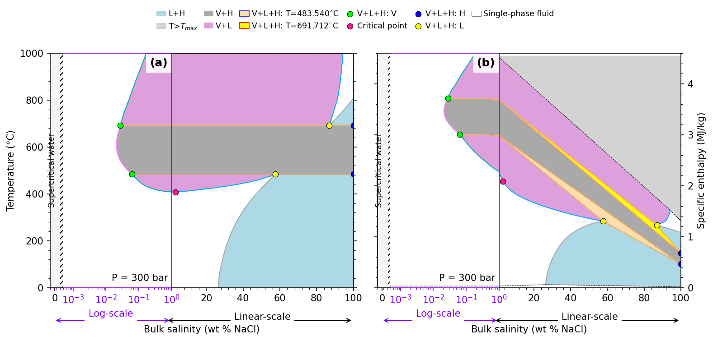
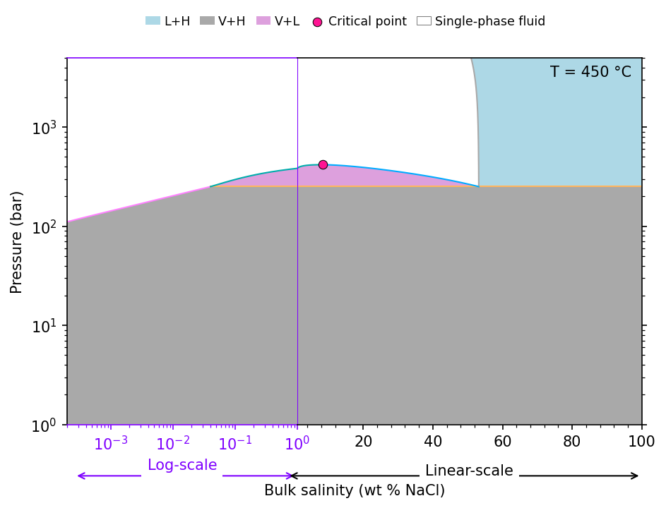
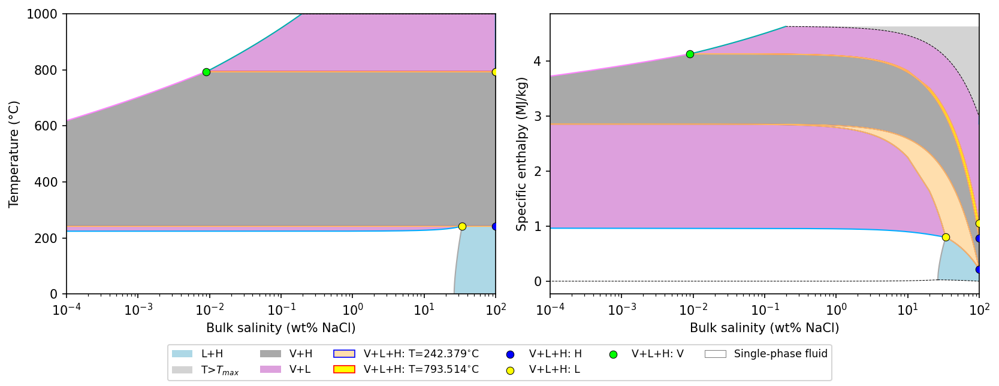

# Phase diagrams

The library computes the geometry of the phase regions of H₂O–NaCl along an isobar or an isotherm from its
phase-boundary correlations:

| Method | Section | Coordinates |
|---|---|---|
| `sw.Slice_constP(p)` | isobaric, at pressure `p` [Pa] | T–X and H–X |
| `sw.Slice_constT(T)` | isothermal, at temperature `T` [K] | P–X |

Each result holds the polygons of the multiphase regions (V+L, V+H, L+H, V+L+H), their boundary lines and the
invariant points, with names and colours. The plotting helpers draw them with Matplotlib (`pip install ".[plotting]"`).
Unshaded areas are single-phase fluid. The axes are labelled in °C, bar, wt% NaCl and MJ/kg.

Because these diagrams draw the computed boundaries, they do not depend on a grid resolution (a few known
inaccuracies are noted [below](#your-own-axes-plot_slice)). A grid of phase codes, by
contrast, has staircase edges, and contour plots of it interpolate between categories that have no order. Use
`plot_phases` ([Property maps](property_maps.md)) only where no section is available, for example for pure water.

## A complete isobaric figure: plot_Pslice

`xthermo.plot_Pslice(P0, x0_log_linear=0.01, sw=None)` draws temperature (a) and specific enthalpy (b) against
salinity at pressure `P0`. The salinity axis is logarithmic below `x0_log_linear` (kg/kg; 1 wt% by default) and
linear above, with a strip for pure water (X = 0) on the left.



```python
--8<-- "docs/gallery/guide_phase_diagrams.py:pslice"
```

At 300 bar, above the critical pressure of water, the vapour + liquid region (pink) begins at the critical point of
the mixture at about 408 °C. The vapour + halite region (grey) lies between the two temperatures of the three-phase
assemblage V+L+H (484 and 692 °C), and liquid + halite (blue) bounds the salt-rich side. In the enthalpy section (b),
V+L+H is not a line but a region (yellow, orange), because the phase proportions change at constant temperature.

`plot_Pslice` returns a dictionary: `fig`, `data` (the `Slice_constP` result), `ax_T` and `ax_H` (the log and linear
halves of each panel), `ax_water` and `handles` (for a legend of your own).

## An isothermal figure: plot_Tslice

`xthermo.plot_Tslice(T0, x0_log_linear=0.01, sw=None, plog=True)` draws pressure against salinity at temperature
`T0`, with a logarithmic pressure axis by default.



```python
--8<-- "docs/gallery/guide_phase_diagrams.py:tslice"
```

## Your own axes: plot_slice

`xthermo.plot_slice(ax, section, x="X", y=None, regions=True, lines=True, points=True, legend=False)` draws a section
on Matplotlib axes you create, so you can combine it with other plots. `x` and `y` are `"T"`, `"P"`, `"X"` or `"H"`;
`y` defaults to `"T"` for an isobaric and `"P"` for an isothermal section. `ax` can also be a list of axes. It returns
`{label: artist}` for a legend.



```python
--8<-- "docs/gallery/guide_phase_diagrams.py:slice"
```

At 25 bar, below the critical pressure of water, there are two three-phase temperatures (242 °C and 794 °C), and
vapour + halite covers most of the diagram between them.

Set the scale of the axes (`ax.set_xscale("log")`) before or after calling `plot_slice`; the polygons are drawn in
data coordinates. Pure water, X = 0, cannot be shown on a log axis: `plot_Pslice` adds the strip for it.

!!! note "Known limitations of the section geometry"
    The section geometry is checked against the equation of state point by point in the test suite, and agrees away
    from the boundaries. Three details of the library's geometry are known to be inaccurate: in isobaric H–X sections
    below about 221 bar a thin sliver of the vapour + liquid region at salinities below 0.13 wt% NaCl is missing; in
    isothermal sections the liquid + halite region continues below the three-phase pressure, where vapour + halite is
    stable (the plotting helpers draw vapour + halite on top, so the figure is correct); and isothermal sections
    below 374 °C contain a spurious "critical point" at X = 0. They are listed with the other
    [known defects](../limitations.md#confirmed-numerical-defects).

## Axis helpers

`plot_Pslice` and `plot_Tslice` are built from two helpers you can also use directly:

- `xthermo.makeLogLinearAxes(ax, width_logaxis=0.4, xlim_log=(2e-3, 1), xmax=100, ...)` replaces `ax` by a salinity
  axis that is logarithmic up to `xlim_log[1]` wt% and linear above. It returns `(ax_log, ax_linear)`; draw on both,
  e.g. `plot_slice([ax_log, ax_linear], section)`.
- `xthermo.createWaterAxes(ax_log)` adds the narrow strip for pure water at the left of the log axis.
