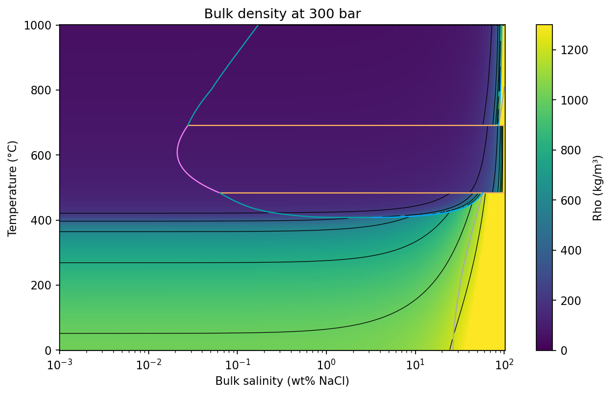
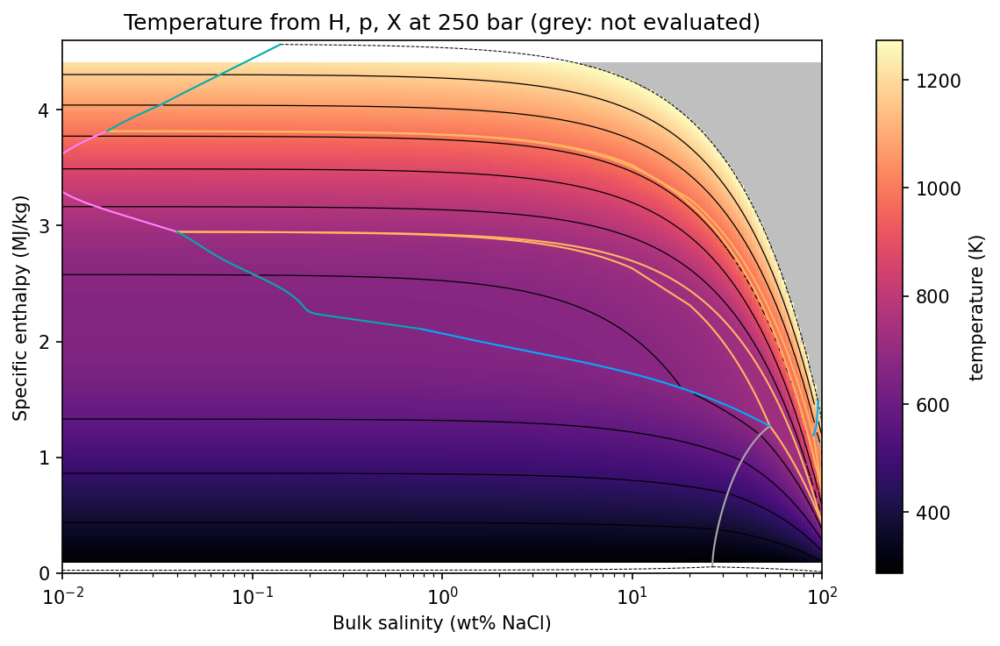
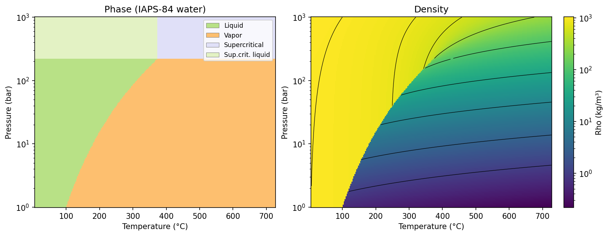

# Property maps

Evaluate a grid with `xthermo.tpx` or `xthermo.hpx`, then draw it with two helpers (Matplotlib required):

```text
xthermo.plot_property(ax, states, field, x="X", y="T", *, cmap="viridis", norm=None,
                      vmin=None, vmax=None, contours=None, contour_kw=None, colorbar=True,
                      failed="0.75", label=None)
xthermo.plot_phases(ax, states, x="X", y="T", *, legend=True, failed="0.75")
```

- `states` must be a **2-D** result: broadcast one input along each axis, e.g. `T[:, None]` and `X[None, :]`.
- `x` and `y` are `"T"`, `"P"`, `"X"` or `"H"`. Axes are labelled in °C, bar, wt% NaCl and MJ/kg; the property and
  its colour bar stay in SI units.
- **Each point is one cell** (`pcolormesh`); nothing is interpolated. On a logarithmic axis the cells are centred in
  log space, so set the axis scale to match your grid.
- **Points that were not evaluated** (`states.ok` is False) are drawn in the colour `failed` (grey; `None` to leave
  them out). Evaluate with `errors="nan"` so that such points don't stop the grid.
- **Contours are drawn separately in each phase assemblage** (liquid, vapour, V+L, L+H, V+H, V+L+H). A contour line
  therefore ends at a phase boundary instead of being interpolated across it, where many properties jump.
- `plot_property` returns `{"mesh", "contours", "colorbar", "failed"}`; `contours` is a dict of contour sets keyed by
  assemblage. `plot_phases` returns `{"mesh", "handles"}`.

## A property map with section boundaries

The bulk density at 300 bar, with the boundaries of the phase regions drawn on top by
[`plot_slice`](phase_diagrams.md#your-own-axes-plot_slice):



```python
--8<-- "docs/gallery/guide_property_maps.py:density"
```

In the multiphase regions the map shows the **bulk** density of the phase assemblage (Σ S<sub>i</sub> ρ<sub>i</sub>).
Other bulk fields have restricted meanings there; check
[the field table](evaluate.md#properties) before mapping `Cp`, `Mu` or the derivatives. Use phase fields such as
`Rho_l` with `absent="nan"` to map a property of one phase only.

## Enthalpy grids

The H of an `hpx` result is the enthalpy of the returned state, which can differ slightly from the requested value
(and, at X = 1, pure NaCl in the H₂O–NaCl model, inside the melting range substantially:
[Under investigation](../limitations.md#under-investigation)).
So give the grid's enthalpy axis as the input values, `y=("H", H)`, rather than reading it from the result:



```python
--8<-- "docs/gallery/guide_property_maps.py:temperature"
```

The grey area is where `hpx` did not evaluate: enthalpies above the enthalpy at the upper temperature limit of the
model (1000 °C). The three-phase assemblage V+L+H, a line in temperature, is a band in enthalpy (between the orange
lines), and temperature is constant across it.

## Phase maps

`plot_phases` colours each point by its phase code, with a legend of phase names. Use it where no section geometry
exists, as for pure water in temperature and pressure:



```python
--8<-- "docs/gallery/guide_property_maps.py:water"
```

The density contours stop at the boiling curve, where liquid and vapour meet and the density jumps. They also stop
where the library's label changes from "Vapor" to a supercritical code at the critical pressure, which is not a
physical boundary.
