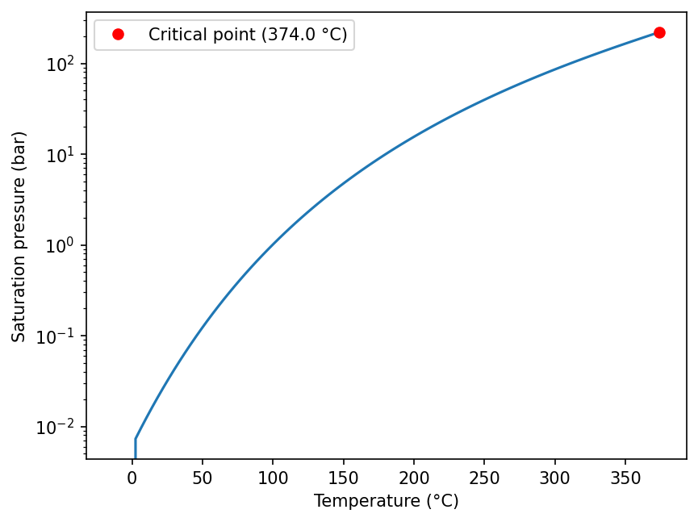

# Pure water and NaCl

## Water

`xthermo.H2O` has two equations of state for pure water:

| Class | Formulation |
|---|---|
| `H2O.cIAPS84()` | IAPS-84 (Haar, Gallagher & Kell 1984), computed with PROST 4.1. The reference backend of the Driesner H₂O–NaCl model |
| `H2O.cIAPWS95()` | IAPWS-95 (Wagner & Pruß 2002) |

They are evaluated with `xthermo.tpx` and `xthermo.hpx` like the brine model; `X` is ignored.

```python
import numpy as np
import xthermo
from xthermo import H2O

water = H2O.cIAPS84()
T = np.array([20.0, 200.0, 400.0]) + 273.15                 # K
s = xthermo.tpx(water, T, 250e5)                            # 250 bar
print(s.phase_name)
print(s.Rho, "kg/m³")
print(s.Mu, "Pa s")
```

At pressures above the critical pressure of water (220.5 bar with IAPS-84, 220.6 bar with IAPWS-95), the library
labels a fluid below the
critical temperature "Sup.crit. liquid" and one above it "Supercritical".

In the two-phase states of the water models, `S_v` is the vapour **mass** fraction (quality), not a volume fraction
as in H₂O–NaCl. See [Evaluating states](evaluate.md#properties).

### Saturation



```python
--8<-- "docs/gallery/gallery_water.py:boiling"
```

`Boiling_p(T)` gives the saturation pressure and `Boiling_T(p)` the saturation temperature. `Boiling_p_props(T)`
returns the saturated liquid and vapour:

```python
from xthermo import H2O

water = H2O.cIAPS84()

T = 300 + 273.15   # K
prop = water.Boiling_p_props(T)

print(f"Saturation pressure: {prop.p/1e5:.2f} bar")
print(f"Liquid density:      {prop.Rho_l:.1f} kg/m³")
print(f"Vapour density:      {prop.Rho_v:.3f} kg/m³")
print(f"Boiling point at 1 bar: {water.Boiling_T(1e5) - 273.15:.2f} °C")
```

The IAPWS-95 class has the same methods: `water = H2O.cIAPWS95()`. Exactly on the saturation curve, IAPWS-95 water
evaluated with `tpx` raises `NotConvergedError`; evaluate slightly off it, or use the saturation functions.

## NaCl

`xthermo.NaCl.cNaCl("IAPS84")` is the pure NaCl model of Driesner (2007): halite (solid) and liquid NaCl, with their
melting, sublimation and boiling curves. Its liquid properties are the Driesner brine correlations at X = 1, which
use a water equation of state; the argument selects it.

```python
import numpy as np
import xthermo
from xthermo import NaCl

nacl = NaCl.cNaCl("IAPS84")
print(f"melting point at 1 bar: {nacl.Melting_T(1e5) - 273.15:.1f} °C")

T = np.array([500.0, 900.0]) + 273.15
s = xthermo.tpx(nacl, T, 1e5)                       # X is ignored
print(s.phase_name)                                 # ['Solid' 'Liquid']
print(s.Rho, "kg/m³")
```

The NaCl model reports its properties in the bulk fields only (`Rho`, `H`, `Cp`, …). It has no enthalpy-based
input: `hpx` raises `NotAvailableError`. The properties of pure NaCl have not been independently verified in the
review of xThermo; see [Model and limitations](../limitations.md#under-investigation).
